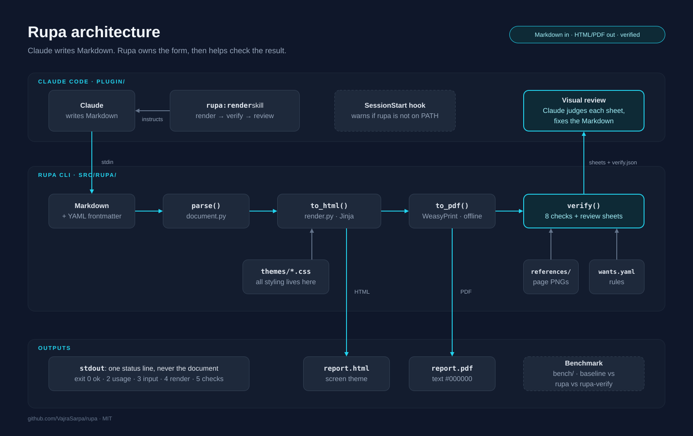
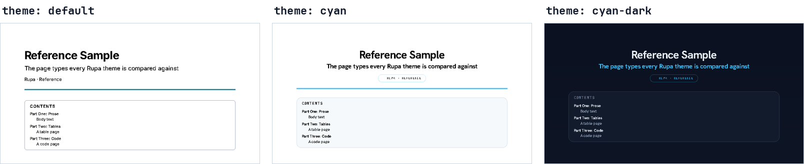
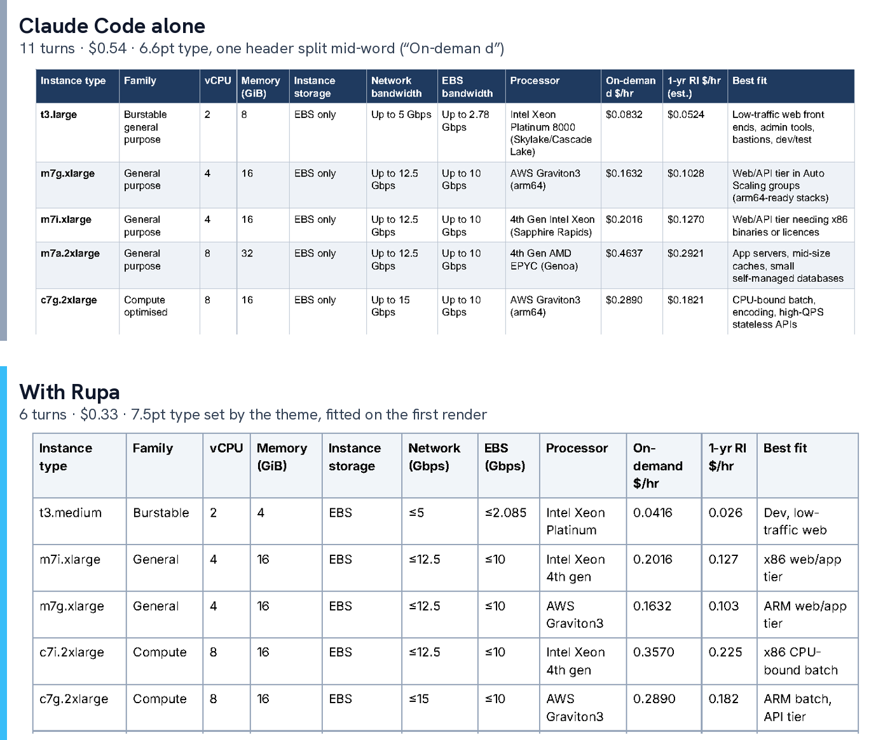

# Rupa

[](https://github.com/VajraSarpa/rupa/actions/workflows/ci.yml)

**Claude writes the content. Rupa owns the form.**

Rupa is a command-line renderer and a Claude Code plugin. Claude writes plain
Markdown; Rupa turns it into a themed HTML page or PDF, checks the PDF with
code, and shows Claude page images only when something looks wrong. *Rūpa*
is Sanskrit for "form".

**Read the story:** [the case study](docs/dist/Rupa-Case-Study.pdf) covers why Rupa
exists, how it was measured, and what the measurements forced me to fix.

## Results

Claude Code with the plugin, against Claude Code on its own, on three real
document tasks (Claude Opus 5.5, three runs per arm, medians, API list
prices, October 2026):

| | Claude Code alone | With Rupa | Gain |
|---|---|---|---|
| Cost per document | $0.52 – $1.19 | $0.29 – $0.33 | **40–74% cheaper** |
| Time per document | 112 – 252 s | 36 – 52 s | **2.4–5.6× faster** |
| Context added per document | 12,200 – 34,300 tokens | 3,800 – 5,800 tokens | **61–86% less** |
| PDFs passing `rupa verify` | 0 of 9 | 9 of 9 | |

All three gains come from the same place: Claude stops writing and re-reading
markup, and Rupa answers with one status line instead of the document. The
hardest task, a three-page technical guide, shows the widest gap: 23 turns,
$1.19 and four minutes alone, against 6 turns, $0.31 and 45 seconds with Rupa.
Details, caveats and projections at volume are in
[What Rupa Costs](docs/dist/Rupa-Cost-Analysis.pdf).

## How it works



1. **Claude writes Markdown** with a little frontmatter: title, subtitle,
   author, date, theme, contents and an optional page budget.
2. **`rupa` renders it** through a theme into HTML or PDF, offline. Given a
   page budget, it tightens type and spacing to fit, and if that isn't
   enough, it says how many lines to cut.
3. **`rupa verify` checks the PDF** with eight code checks and writes
   side-by-side sheets (the theme's reference page next to the rendered page)
   only for the pages a check flags.
4. **Claude reviews the flagged sheets** and fixes the Markdown, never the
   CSS. Rupa itself never calls a model.

## Install

Rupa needs Python 3.11+, [uv](https://docs.astral.sh/uv/), and Pango for
WeasyPrint (`sudo apt install libpango-1.0-0 libpangoft2-1.0-0` on Debian or
Ubuntu, `sudo dnf install pango` on Fedora, `brew install pango` on macOS).

```bash
uv tool install git+https://github.com/VajraSarpa/rupa     # puts rupa on PATH
claude plugin marketplace add VajraSarpa/rupa
claude plugin install rupa@rupa                            # the Claude Code plugin
```

Then ask Claude Code for a PDF or an HTML page. The `rupa:render` skill takes
it from there.

## Use it directly

```bash
cat > report.md <<'EOF'
---
title: Quarterly Review
subtitle: What shipped and what's next
theme: cyan
toc: false
pages: 2
---

## Summary

Markdown in, **verified** PDF out.
EOF

rupa report.md -o report.pdf
# rupa: wrote report.pdf (pdf, 1 page, 8,629 bytes)
rupa verify report.pdf
# verify: 8/8 checks pass
```

Supported Markdown: CommonMark, tables, strikethrough, task lists, footnotes
and fenced code with syntax highlighting. Raw HTML is escaped, and images
must be PNG, JPEG, GIF, WebP or SVG files next to the Markdown (HTML output
embeds them).

## Themes



| Theme | On screen (HTML) | PDF |
|---|---|---|
| `default` | Slate on white, light or dark with the system | Black on white |
| `cyan` | Deep navy, blueprint grid, one cyan accent | Black on white, cyan rules and pills |
| `cyan-dark` | Same as `cyan` | Navy pages, light ink |

A different look is always a theme change, never styling in the Markdown.
PDFs use bundled fonts (Inter, Hanken Grotesk, JetBrains Mono; SIL OFL 1.1),
so a PDF looks the same on every machine.

## Verification

`rupa verify` checks text colour, page size, page count, empty and sparse
pages, stranded headings and overflow, and reports exactly what and where
(`p1 table by 13pt`). It reads the theme from the PDF, so it compares against
the right reference pages without being told. A clean PDF gets no sheets, so
the visual review costs nothing when nothing is wrong. `wants.example.yaml`
lists every rule and its default.

## Limits

- **Claude Code only, for now.** Rupa is a local CLI plus a Claude Code
  plugin; it doesn't run in the Claude chat app.
- **HTML and PDF only.** No slides or DOCX yet.
- **Looks come from themes.** A new look means writing a theme in CSS.
- **Markdown limits.** No callouts; footnotes become endnotes in PDFs; bare
  URLs aren't clickable.
- **A cost floor.** About $0.19 of every run is Claude Code starting a
  session, so short, simple documents save the least.
- **A small sample.** Three runs per arm, one model, one person's tasks.

## How the results were found

The benchmark (`bench/`) gives `claude -p` the same prompt in a fresh, empty
folder, across four arms: no plugin, Rupa render-only, Rupa with a sheet per
page type, and Rupa as shipped. The first benchmark found no saving. It took
page budgets, flagged-only review sheets and line-based cut hints to get to
the numbers above.

The wide-table task is the clearest example of measuring and then fixing.
Every first draft overflowed, and at first Rupa saved only 13%, because
Claude kept shrinking cell text. Claude Code alone turned the page to
landscape or shrank the type to 6.6pt. After the theme learned to set wide
tables in smaller type, every Rupa run fitted on its first render, 40%
cheaper:



Every run is published as data in [`bench/data/`](bench/data/): 101 runs
with turns, cost, time, tokens, context and each PDF's verify result, plus
medians that name the published numbers they back. The story of what changed
between runs is in the build guide ([PDF](docs/dist/Rupa-Plan-Guide-Tutorial.pdf),
section "Measuring the savings").

## Contract

The plugin and its evals depend on this.

- **Input:** Markdown with optional YAML frontmatter, from a file or stdin.
- **`-o PATH`:** the output file; the format comes from the extension.
- **`pages: N` or `--pages N`:** a PDF page budget.
- **stdout:** one status line (or one JSON object with `--json`), never the
  document.
- **Exit codes:** `0` ok, `2` usage, `3` bad input, `4` render failure, `5`
  verify checks failed or a PDF still over its page budget.
- **Subcommands:** `rupa verify` and `rupa refs`. To render a Markdown file
  named `verify` or `refs`, write `./verify`.
- **Failure log:** every run that exits non-zero or crashes is appended to
  `~/.rupa/log.jsonl` (time, arguments, exit code, output, traceback if any,
  each clipped to 2,000 characters). Only you can read it, and past 1 MB it
  moves to `log.jsonl.1`. `RUPA_LOG=<path>` moves it; `RUPA_LOG=off` stops it.

## Repository

| Path | What it is |
|---|---|
| `src/rupa/` | The CLI: `rupa` (render), `rupa verify` (check a PDF), `rupa refs` (rebuild reference pages) |
| `src/rupa/themes/` | Theme CSS, a print layer per theme, and the bundled fonts |
| `src/rupa/references/` | The reference pages each theme is compared against |
| `plugin/` | The Claude Code plugin: one skill that renders, verifies and reviews |
| `plugin/evals/` | A `claude plugin eval` suite: does the skill trigger, render with Rupa and pass verify |
| `bench/` | The four-arm benchmark, a fake `claude` for testing it without spending tokens, and `data/` with every run |
| `docs/` | The build guide, cost analysis and architecture diagram, with their sources |

## Develop

```bash
uv sync
uv run pytest -q                   # 166 tests
uvx ruff check src tests
uv run rupa refs --theme <name>    # after any theme change; commit the PNGs
uv run python docs/build.py        # re-render the guide with Rupa
claude plugin validate ./plugin    # after any edit to plugin/
```

A golden-render test in CI renders a sample with every theme and fails if a
page drifts from its committed reference image.

## License

MIT
